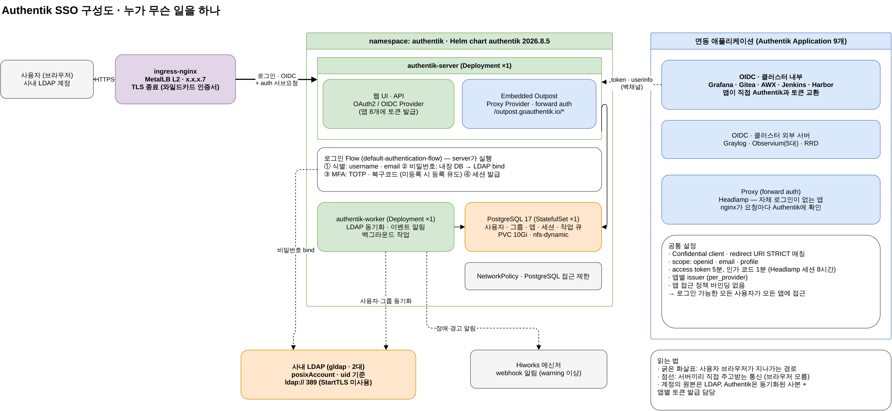
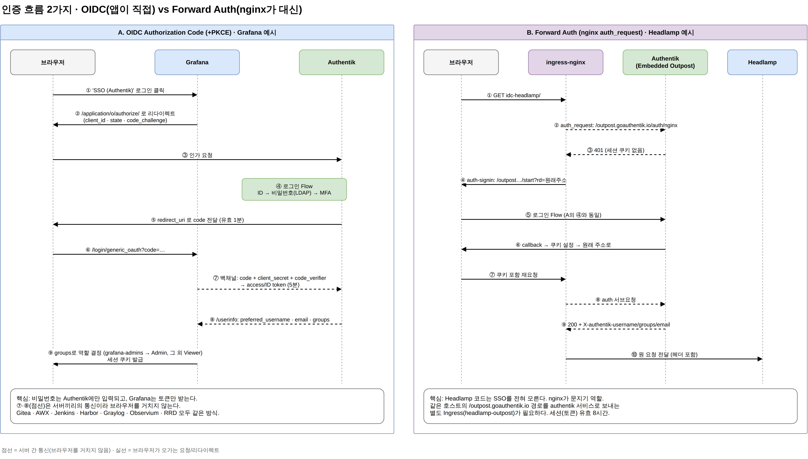

## 시나리오

- **목적**: 사내 운영 도구마다 따로 있던 로그인을 Authentik 하나로 모은 구성을 분석한다. SSO를 처음 보는 사람도 "로그인 버튼을 누르면 뒤에서 무슨 일이 일어나는지" 따라갈 수 있게 정리한다.
- **상황 요약**: Grafana, Gitea, AWX, Jenkins, Harbor 같은 도구가 각자 LDAP에 붙어 있었다. 쿠버네티스 클러스터에 Authentik을 Helm으로 올리고, 도구들이 LDAP 대신 Authentik에 로그인을 맡기도록 바꿨다. 처음에는 임시 도메인([sslip.io](http://sslip.io/))으로 시험한 뒤 사내 도메인과 정식 인증서로 옮겼다.
- **분석 방법**: 서버에서는 **조회 명령만** 실행했다. `kubectl get`, Helm values, 각 앱 설정 파일, 그리고 Authentik 내부 객체는 `ak shell`로 읽기만 했다.

```text
구성요소 파악 → 계정 출처(LDAP)와 로그인 Flow → 앱 연동 방식 2가지 → 도메인 전환 작업 → 리스크 점검
```

> 글에 나오는 공인 IP는 `x.x.x`로, 사내 도메인은 `&lt;도메인&gt;`으로 가렸다. Client ID·Secret 같은 비밀값은 싣지 않았다.

## 0. 먼저, Authentik은 무엇을 하나

SSO(Single Sign-On)는 "한 번 로그인하면 여러 서비스를 쓸 수 있게" 하는 것이다. 핵심은 **비밀번호를 받는 곳을 한 군데로 모으는 것**이다. 각 앱은 사용자의 비밀번호를 보지 않고, Authentik이 "이 사람은 누구다"라고 서명해 준 토큰만 받는다.

Authentik은 이 역할을 하는 오픈소스 IdP(Identity Provider)[^idp]다. 처음 보면 용어가 많은데, 이번 구성에 실제로 쓰인 것만 추리면 아래와 같다.

| 개념 | 한 줄 설명 | 이번 구성에서 |
| --- | --- | --- |
| Application | 로그인을 맡길 앱 하나 | Grafana, Gitea 등 9개 |
| Provider | 앱과 대화하는 방식(프로토콜) | OAuth2/OIDC 8개, Proxy 1개 |
| Source | 사용자 계정을 어디서 가져오나 | 사내 LDAP 1개 (+ 내장 DB) |
| Flow / Stage | 로그인 화면의 단계 순서 | ID → 비밀번호 → MFA → 세션 |
| Outpost | Provider를 실제로 처리하는 프로세스 | server에 내장된 Embedded Outpost |
| Policy / Binding | 누가 어떤 앱에 들어갈 수 있나 | 앱 단위 바인딩 없음 (5장) |
| Notification | 이벤트를 어디로 알리나 | Hiworks 메신저 webhook |

## 1. 구성 — 무엇이 어디에 떠 있나



```bash
helm -n authentik list                       # chart authentik-2026.8.5, revision 2
kubectl -n authentik get deploy,sts,svc,ingress,pvc,networkpolicy
```

| 구성요소 | 종류 · 수량 | 하는 일 |
| --- | --- | --- |
| authentik-server | Deployment × 1 | 웹 UI, API, OIDC 토큰 발급, 로그인 Flow 실행, Embedded Outpost |
| authentik-worker | Deployment × 1 | LDAP 동기화, 알림 발송, 예약 작업 같은 백그라운드 일 |
| PostgreSQL 17 | StatefulSet × 1, PVC 10Gi (nfs-dynamic) | 사용자·그룹·앱·세션과 작업 큐까지 전부 저장 |
| Ingress | nginx, `idc-sso.&lt;도메인&gt;` | MetalLB IP(`x.x.x.7`)로 들어온 HTTPS를 server로 전달 |
| NetworkPolicy | PostgreSQL 대상 | DB 접근을 authentik 파드로 제한 |

두 가지가 눈에 띈다.

- **Redis가 없다.** 예전 Authentik은 캐시·작업 큐로 Redis가 필수였지만, 2025.10 이후 버전은 이 역할을 PostgreSQL로 옮겼다. 그래서 구성요소가 server, worker, DB 세 개로 단순해졌다. 대신 **DB 하나가 멈추면 로그인·세션·작업이 모두 멈춘다.**
- **Outpost가 따로 없다.** forward auth용 Outpost를 별도 파드로 띄울 수도 있지만, 여기서는 server 안의 Embedded Outpost를 그대로 쓴다. 파드 수는 줄지만 server 장애가 곧 forward auth 장애다.

Helm values는 아주 짧다. 비밀값을 빼면 이게 전부다.

```yaml
authentik:
  error_reporting: { enabled: false }       # 외부로 오류 리포트 안 보냄
server:
  replicas: 1
  ingress:
    enabled: true
    ingressClassName: nginx
    annotations:
      nginx.ingress.kubernetes.io/proxy-buffer-size: "16k"   # 큰 OIDC 헤더/쿠키 대비
    hosts: [ idc-sso.<도메인> ]
    tls: [ { hosts: [ idc-sso.<도메인> ], secretName: wildcard-tls } ]
worker:
  replicas: 1
postgresql:
  enabled: true
  primary:
    persistence: { enabled: true, storageClass: nfs-dynamic, size: 10Gi }
```

## 2. 계정은 어디서 오나 — LDAP Source와 로그인 Flow

### 2-1. LDAP Source: 계정의 원본은 여전히 LDAP

Authentik이 새 계정 저장소가 된 것이 아니다. **계정의 원본은 사내 LDAP이고**, Authentik은 worker가 주기적으로 사용자·그룹을 동기화해서 사본을 갖는다.

| 항목 | 값 | 의미 |
| --- | --- | --- |
| 서버 | LDAP 2대 (`ldap://`) | 한 대가 죽어도 다른 쪽으로 붙는다 |
| 사용자 필터 | `(objectClass=posixAccount)` | 리눅스 계정 형태의 사용자만 가져온다 |
| 고유 키 | `uid` | LDAP의 uid가 Authentik username이 된다 |
| 그룹 동기화 | 켜짐 | LDAP 그룹을 Authentik 그룹으로 가져온다 |
| StartTLS | **꺼짐** | 비밀번호가 평문으로 LDAP까지 간다 (5장) |
| 비밀번호 저장 | 안 함 | Authentik DB에 LDAP 비밀번호를 복사해 두지 않는다 |

조회 시점 기준 활성 사용자는 106명이다.

### 2-2. 로그인 Flow: 화면 한 장 뒤의 4단계

사용자가 보는 로그인 화면은 하나지만, 뒤에서는 Stage 4개가 순서대로 돈다.

| 순서 | Stage | 설정 | 하는 일 |
| --- | --- | --- | --- |
| 10 | Identification | username, email | "누구세요?" |
| 20 | Password | 내장 DB → Token → **LDAP** | 비밀번호 확인. 내장 계정이 아니면 LDAP에 bind해서 맞는지 묻는다 |
| 30 | Authenticator Validate | TOTP, 복구코드 · 미등록 시 **등록 강제** | MFA. 등록 안 한 사용자는 이 자리에서 OTP 앱 등록부터 하게 된다 |
| 100 | User Login | 세션 유지 기본값 | 세션 쿠키 발급 |

> **MFA가 사실상 필수**라는 점이 중요하다. `not_configured_action=configure`라서 OTP를 등록하지 않고는 로그인을 끝낼 수 없다. LDAP 비밀번호만 알아서는 어떤 앱에도 들어갈 수 없다는 뜻이다.

## 3. 앱을 붙이는 두 가지 방식



### 3-1. OIDC — 앱이 SSO를 알 때 (8개)

Grafana처럼 "OAuth 로그인" 기능이 있는 앱은 OIDC[^oidc]로 붙인다. 흐름의 핵심은 그림 A의 ⑦·⑧이다. 브라우저는 1분짜리 **인가 코드**만 들고 다니고, 진짜 토큰은 앱 서버가 Authentik과 **백채널**로 직접 교환한다. 그래서 앱은 비밀번호를 한 번도 보지 않는다.

모든 OIDC Provider는 같은 틀을 쓴다.

- Confidential client (앱 서버가 Client Secret을 가짐)
- Redirect URI **STRICT** 매칭: 등록한 주소와 한 글자라도 다르면 거부
- scope: `openid email profile` (Harbor만 `offline_access` 추가)
- 인가 코드 1분, access token 5분, 앱마다 별도 issuer (`/application/o/&lt;slug&gt;/`)

| 앱 | 위치 | 앱 쪽 설정 방식 | 메모 |
| --- | --- | --- | --- |
| Grafana | 클러스터 | kube-prometheus-stack values의 `auth.generic_oauth`, Secret은 `envFromSecret` | PKCE 사용, groups로 역할 매핑, LDAP 로그인 비활성화 |
| Gitea | 클러스터 | init 컨테이너가 `gitea admin auth add-oauth` 실행 | 기존 계정 자동 연결(ACCOUNT_LINKING), 자동 가입 |
| AWX | 클러스터 | AWX 설정의 OIDC 항목 | Authentik 쪽 Provider와 연결 확인 |
| Jenkins | 클러스터 | `oic-auth` 플러그인 + well-known URL | 플러그인을 오프라인으로 받아 PVC에 복사 후 재시작 |
| Harbor | 클러스터 | Harbor 관리 API의 `auth_mode` = oidc_auth | refresh token용 offline_access |
| Graylog | 외부 서버 | 각 서버 설정 | 클러스터 밖 앱도 같은 IdP 사용 |
| Observium | 외부 서버 5대 | Provider 하나에 redirect URI 5개 | 같은 앱 여러 대를 Provider 하나로 묶음 |
| RRD | 외부 서버 | 각 서버 설정 |  |

Grafana 설정이 OIDC 연동의 전형적인 모양이다.

```yaml
grafana:
  envFromSecret: grafana-oidc               # Client Secret은 Secret으로만
  grafana.ini:
    auth.ldap: { enabled: false }           # LDAP 직접 로그인 끔
    auth:
      signout_redirect_url: https://idc-sso.<도메인>/application/o/grafana/end-session/
    auth.generic_oauth:
      enabled: true
      name: SSO (Authentik)
      scopes: openid email profile
      auth_url:  https://idc-sso.<도메인>/application/o/authorize/
      token_url: https://idc-sso.<도메인>/application/o/token/
      api_url:   https://idc-sso.<도메인>/application/o/userinfo/
      login_attribute_path: preferred_username
      role_attribute_path: "contains(groups[*], 'grafana-admins') && 'Admin' || contains(groups[*], 'grafana-editors') && 'Editor' || 'Viewer'"
      use_pkce: true
```

`role_attribute_path`가 "권한은 누가 정하나"에 대한 답이다. **Authentik은 "이 사람이 어떤 그룹에 있다"까지만 알려 주고, 그 그룹을 어떤 권한으로 바꿀지는 앱이 정한다.**

### 3-2. Forward Auth — 앱이 SSO를 모를 때 (Headlamp)

Headlamp(쿠버네티스 웹 대시보드)는 OIDC 로그인 기능을 쓰지 않았다. 이런 앱은 **앞단 nginx가 문지기**를 한다. nginx의 `auth_request`[^authreq]로 요청이 올 때마다 Authentik에 "이 쿠키 로그인된 거 맞아?"를 묻고, 200이면 통과, 401이면 로그인 화면으로 보낸다.

필요한 것은 Ingress 두 개다.

```yaml
# (A) 보호할 앱의 Ingress: 요청마다 Authentik에 물어본다
nginx.ingress.kubernetes.io/auth-url: http://authentik-server.authentik.svc.cluster.local/outpost.goauthentik.io/auth/nginx
nginx.ingress.kubernetes.io/auth-signin: https://idc-headlamp.<도메인>/outpost.goauthentik.io/start?rd=$scheme://$http_host$escaped_request_uri
nginx.ingress.kubernetes.io/auth-response-headers: Set-Cookie,X-authentik-username,X-authentik-groups,X-authentik-email,X-authentik-name,X-authentik-uid
nginx.ingress.kubernetes.io/auth-snippet: proxy_set_header X-Forwarded-Host $http_host;
```

```yaml
# (B) 같은 호스트의 /outpost.goauthentik.io 경로만 Authentik으로 보낸다 (namespace: authentik)
spec:
  rules:
    - host: idc-headlamp.<도메인>
      http:
        paths:
          - path: /outpost.goauthentik.io
            pathType: Prefix
            backend: { service: { name: authentik-server, port: { number: 80 } } }
```

- `auth-url`은 클러스터 내부 주소(`svc.cluster.local`)를 쓴다. 서브요청이 외부로 나갔다 들어오지 않아서 빠르고, 인증서 검증 문제도 없다.
- (B)가 필요한 이유는 **쿠키 도메인** 때문이다. 로그인 완료 콜백이 Headlamp와 같은 호스트에서 끝나야 그 호스트용 세션 쿠키를 심을 수 있다.
- Provider 모드는 `forward_single`(앱 하나 = 도메인 하나). 세션 유효 시간은 8시간이다.

> 먼저 `traefik/whoami` 테스트 앱에 같은 annotation을 붙여 `X-authentik-*` 헤더가 들어오는지 확인한 뒤 Headlamp에 적용했다. forward auth는 설정이 틀려도 앱 쪽 에러가 아니라 nginx 401/500으로만 보여서, 헤더를 그대로 찍어 주는 앱으로 먼저 검증하는 게 빠르다.

## 4. 임시 도메인에서 사내 도메인으로 — 전환 작업

처음에는 `sso.x-x-x-7.sslip.io` 같은 임시 도메인[^sslip]과 자체 인증서로 시험했다. 이후 사내 도메인 `idc-sso.&lt;도메인&gt;`과 와일드카드 인증서로 옮겼다.

| 순서 | 작업 | 확인 |
| --- | --- | --- |
| 1 | kube-system에 있던 와일드카드 인증서를 authentik 네임스페이스에 TLS Secret으로 복사 (임시 파일은 `umask 077`로 만들고 `shred`로 삭제) | Secret 존재 확인 |
| 2 | values 백업 → host와 TLS만 교체 → `helm template --show-only .../ingress.yaml`로 렌더 결과 확인 → `helm upgrade` (revision 2) | `curl -sI https://idc-sso.&lt;도메인&gt;/-/health/live/`가 `-k` 없이 200 |
| 3 | Grafana values의 SSO 주소 일괄 치환 후 업그레이드 | Grafana 로그에 oauth 오류 없음 |
| 4 | Gitea: Client ID/Secret을 `read -rs`로 받아 Secret 생성, init 컨테이너에 SSO 등록 스크립트 추가 | `gitea admin auth list`에 authentik 등록 |
| 5 | Jenkins: `oic-auth` 플러그인과 의존성 받기, 기존 plugins 백업 후 복사, StatefulSet 재시작 | 로그에 플러그인 로드 오류 없음 |
| 6 | AWX · Harbor: 앱 파드 안에서 SSO 주소로 health check | 앱 → SSO 통신 200, `.well-known/openid-configuration` 200 |

매 단계 앞에 **"앱 파드 안에서 SSO 주소로 curl"**을 넣은 것이 포인트다. OIDC는 앱 서버가 Authentik에 직접 붙어야 하므로(백채널), 브라우저에서 열리는 것만으로는 부족하다. 파드에서 DNS나 인증서 문제가 있으면 로그인 버튼을 누른 뒤에야 알게 된다.

## 5. 점검 결과 — 지금 구조의 리스크

분석 과정에서 확인한 리스크를 영향도 순서로 정리했다. 조회로 확인한 사실이고, 아직 바꾼 것은 없다.

| # | 항목 | 현재 상태 | 왜 문제인가 | 개선안 |
| --- | --- | --- | --- | --- |
| 1 | 단일 장애점 | server·worker·PostgreSQL 모두 1개, DB는 NFS 위 | SSO가 멈추면 **9개 앱 모두 신규 로그인 불가**. DB는 기존 마스터의 NFS에 묶여 있다 | server 2개 이상, PDB, DB 정기 백업(`pg_dump` CronJob)부터 |
| 2 | LDAP 평문 | `ldap://`, StartTLS 꺼짐 | 로그인할 때마다 비밀번호가 평문으로 LDAP까지 간다 | LDAPS(636) 또는 StartTLS + 인증서 검증 |
| 3 | 앱 접근 정책 없음 | 9개 앱 모두 Policy Binding 0개 | 로그인 가능한 106명 누구나 모든 앱의 로그인 단계를 통과한다. 권한은 앱의 그룹 매핑에만 의존 | 앱별 허용 그룹 바인딩 (예: Jenkins는 운영 그룹만) |
| 4 | 권한 그룹 미사용 | `grafana-admins` 멤버 0명 | Grafana 사용자 전원이 Viewer로 들어온다. 관리자 권한은 수동으로 주고 있을 가능성 | LDAP 그룹과 연결하거나 Authentik 그룹에 멤버 지정 |
| 5 | 리소스 미지정 | requests/limits 없음 | 노드가 바쁠 때 우선 축출 대상(BestEffort) | 최소 requests 지정 |
| 6 | Grafana TLS 검증 끔 | `tls_skip_verify_insecure: true` | 자체 인증서 시절 설정이 남아 있다. 정식 인증서로 바뀌었으니 필요 없다 | 제거 후 로그인 시험 |
| 7 | Jenkins 로그아웃 | `logoutFromOpenidProvider: false` | Jenkins에서 로그아웃해도 SSO 세션이 남아 바로 재로그인된다 | 공용 PC 사용이 있다면 켜기 |
| 8 | 테스트 흔적 | whoami 테스트 매니페스트, 임시 TLS Secret, 미적용 LB 서비스 매니페스트 | 혼란 유발, 오래된 인증서 방치 | 정리 |

좋은 점도 분명하다.

- **MFA 강제**: 비밀번호가 새도 OTP 없이는 못 들어간다.
- **짧은 토큰 수명과 STRICT redirect**: 토큰이 새도 5분이면 끝나고, 공격자 주소로 코드를 빼돌릴 수 없다.
- **비밀값 취급**: Client Secret을 Secret 오브젝트로만 넣고, 입력은 `read -rs`, 확인은 해시 앞자리로만 비교했다.
- **작업 전 백업**: values, Grafana 설정, Jenkins 플러그인 모두 날짜 붙은 백업을 남겼다.

## 6. 정리 — SSO를 붙이며 이해한 것

- **"인증"과 "인가"는 다른 곳에서 한다.** Authentik은 "누구인지"(인증)와 "어떤 그룹인지"까지 책임지고, "무엇을 할 수 있는지"(인가)는 각 앱이 그룹을 보고 정한다. 앞으로 앱 접근 제어는 Authentik Policy Binding으로 한 번 더 거르는 게 맞다.
- **OIDC는 백채널이 생명이다.** 브라우저에서 잘 열려도 앱 파드가 SSO 주소를 못 풀거나 인증서를 못 믿으면 실패한다. 연동 전에 앱 파드 안에서 curl부터.
- **로그인을 모르는 앱도 붙일 수 있다.** Headlamp처럼 OIDC를 안 쓰는 앱은 nginx forward auth로 앞을 막으면 된다. 대신 Ingress가 두 개 필요하고, 세션 관리가 Authentik 쪽으로 넘어온다.
- **SSO는 편해지는 만큼 중요해진다.** 도구 9개의 입구가 하나로 모였기 때문에, Authentik의 가용성(1번)과 LDAP 구간 암호화(2번)가 가장 먼저 손볼 과제다.

## 예상 질문

- **Q. Authentik이 죽으면 이미 로그인한 사람도 쫓겨나나?** OIDC 앱(Grafana, Gitea 등)은 로그인 후 자기 세션 쿠키를 따로 갖기 때문에, 그 세션이 살아 있는 동안은 계속 쓸 수 있다. 새로 로그인하거나 세션이 만료되면 막힌다. 반면 Headlamp(forward auth)는 **요청마다** Authentik에 묻기 때문에 즉시 503/500이 난다.
- **Q. LDAP 비밀번호를 바꾸면 Authentik에도 반영되나?** 그렇다. Authentik은 비밀번호를 저장하지 않고 로그인할 때마다 LDAP에 bind로 확인한다. 바뀐 비밀번호가 바로 적용된다.
- **Q. 앱마다 Client Secret이 다른 이유는?** 하나가 새도 다른 앱으로 번지지 않게 하려는 것이다. issuer도 앱마다 달라서, A앱용 토큰을 B앱에 내밀어도 받아 주지 않는다.
- **Q. 왜 Headlamp만 OIDC가 아닌 forward auth인가?** Headlamp에도 OIDC 기능이 있지만 쿠버네티스 API 서버 쪽 OIDC 설정까지 손대야 제대로 동작한다. forward auth는 앱과 클러스터 설정을 건드리지 않고 Ingress annotation만으로 앞을 막을 수 있어서 먼저 택한 방식이다.

[^idp]: Identity Provider. 사용자가 누구인지 확인(인증)하고, 그 결과를 다른 서비스가 믿을 수 있는 형태(토큰, 어설션)로 발급해 주는 시스템. Okta, Keycloak, Azure AD, Authentik 등이 있다.
[^oidc]: OpenID Connect. OAuth 2.0 위에 "사용자가 누구인지"를 담은 ID 토큰을 얹은 표준. 앱은 브라우저를 IdP로 보냈다가 돌아온 인가 코드를 서버끼리 토큰으로 바꾼다. PKCE는 이 코드를 중간에 가로채도 쓸 수 없게 하는 추가 장치다.
[^authreq]: nginx의 `auth_request` 모듈. 원래 요청을 처리하기 전에 지정한 주소로 서브요청을 보내고, 그 응답 코드(2xx면 허용, 401/403이면 거부)로 통과 여부를 정한다. ingress-nginx에서는 `auth-url` annotation으로 쓴다.
[^sslip]: `1-2-3-4.sslip.io`처럼 IP를 이름에 넣으면 그 IP로 풀어 주는 무료 와일드카드 DNS 서비스. DNS 등록 없이 Ingress 호스트를 시험할 때 편하지만, 외부 서비스에 의존하므로 운영용으로는 사내 도메인으로 옮겨야 한다.
