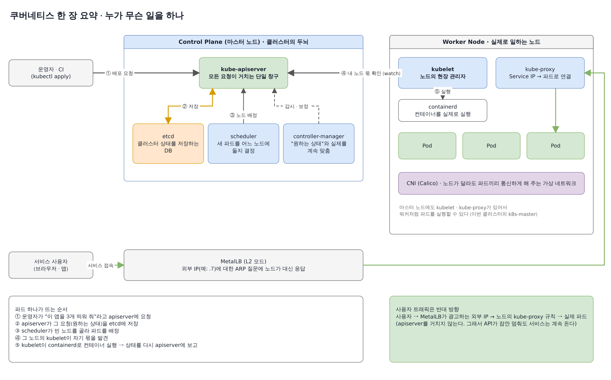
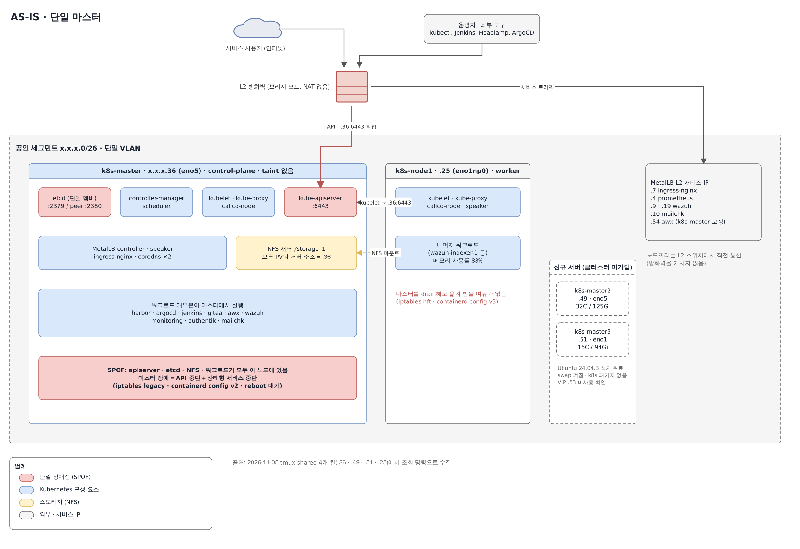
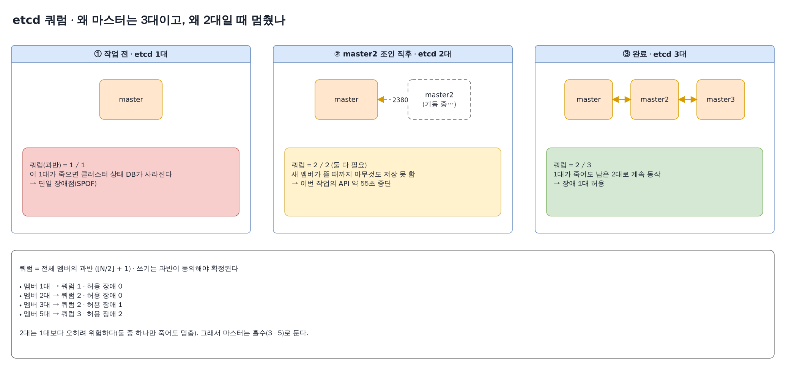
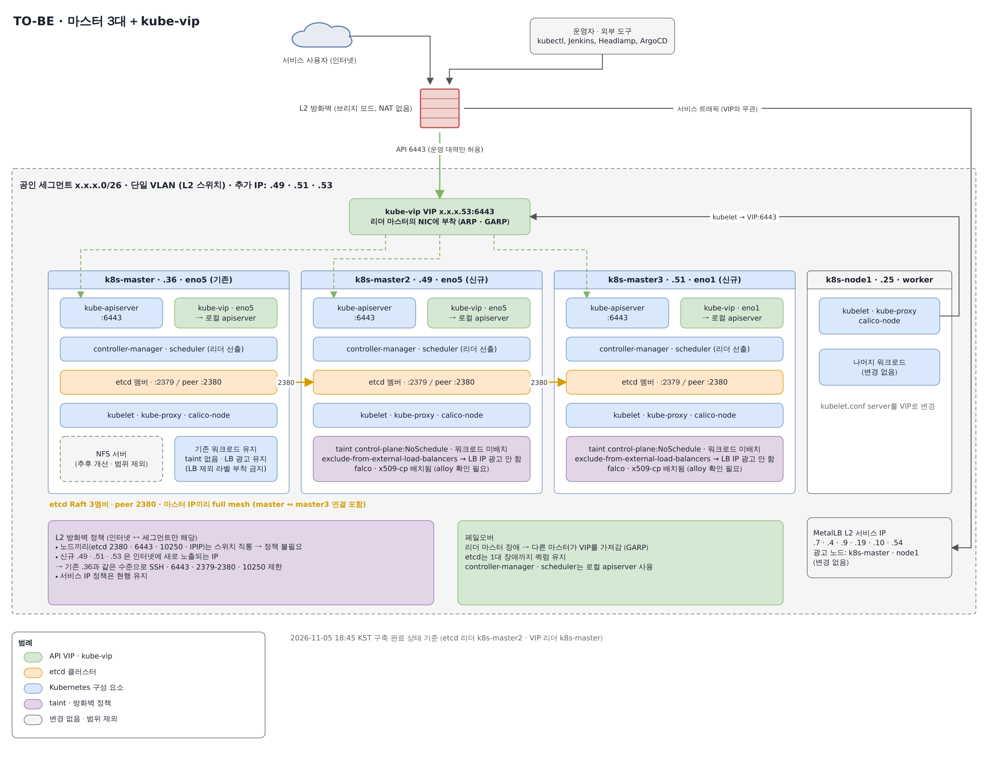

## 시나리오

- **목적**: 쿠버네티스를 잘 모르는 사람도 "마스터를 1대에서 3대로 늘린다"는 작업 하나를 따라가면서, 클러스터가 어떤 부품으로 움직이는지 이해할 수 있게 정리한다.
- **상황 요약**: kubeadm으로 만든 클러스터에 마스터(control-plane)가 1대뿐이었다. 그 1대가 API 서버, 클러스터 DB(etcd), 대부분의 서비스, NFS 스토리지까지 떠안고 있어서 이 서버가 죽으면 전부 멈추는 구조였다. 서버 2대를 새로 받아 마스터를 3대로 늘리고, 앞단에 가상 IP(VIP) 하나를 세웠다.
- **원칙**: 서비스 트래픽은 끊지 않는다. API가 잠깐 멈추는 건 야간 작업창에서 1~2분까지 허용한다. 모든 단계는 조회로 상태를 확인한 다음, 담당자 승인을 받고 한 단계씩 진행했다.

```text
조회로 현황 파악 → 설계 결정 → 백업 → VIP 먼저 도입 → 마스터 조인 → 검증 → 회고
```

> 글에 나오는 공인 IP는 앞자리를 `x.x.x`로 가렸다. `.36`은 기존 마스터, `.49`와 `.51`은 신규 마스터, `.53`은 VIP, `.25`는 워커다.

## 0. 먼저, 쿠버네티스는 어떻게 움직이나



쿠버네티스는 크게 두 부분으로 나뉜다. **Control Plane**(마스터 노드)은 "무엇이 어디서 몇 개 돌아야 하는지"를 기억하고 결정하는 두뇌이고, **Worker Node**는 실제로 컨테이너를 돌리는 일꾼이다.

핵심은 **모든 대화가 kube-apiserver를 거친다**는 점이다. 운영자의 kubectl도, scheduler도, 각 노드의 kubelet도 서로 직접 이야기하지 않고 apiserver에 묻고 apiserver에 보고한다. apiserver는 그 내용을 etcd라는 DB에 저장한다.

| 구성요소 | 한 줄 설명 | 이번 작업에서의 의미 |
| --- | --- | --- |
| kube-apiserver | 모든 요청이 거치는 단일 창구 | 1대뿐이면 이게 멈출 때 아무도 클러스터를 조작할 수 없다 |
| etcd | 클러스터 상태(원하는 상태 + 현재 상태)를 저장하는 DB | 3대로 늘리면서 "쿼럼"이라는 개념이 핵심이 된다 (3장) |
| scheduler | 새 파드를 어느 노드에 둘지 결정 | 마스터마다 하나씩 뜨고, 그중 1개만 리더로 일한다 |
| controller-manager | 원하는 상태와 실제 상태를 계속 맞춤 (파드 3개를 원하면 3개 유지) | scheduler와 같은 리더 선출 방식 |
| kubelet | 각 노드의 현장 관리자. apiserver에서 자기 몫을 받아 컨테이너를 띄운다 | apiserver 주소를 VIP로 바꿔야 한다 |
| kube-proxy | Service IP로 온 트래픽을 실제 파드로 보내는 규칙(iptables)을 관리 | 규칙이 커널에 남아 있어서 API가 멈춰도 트래픽은 흐른다 |
| CNI (Calico) | 노드가 달라도 파드끼리 통신하게 해 주는 가상 네트워크 | 신규 노드가 올바른 IP를 잡는지 확인해야 한다 |
| MetalLB | 외부에서 접속할 IP를 노드가 대신 광고(ARP)해 주는 로드밸런서 | VIP와 역할을 나눠야 한다 |

이 그림에서 가장 중요한 사실 하나는 오른쪽 아래 초록 박스다. **사용자 트래픽은 apiserver를 거치지 않는다.** 외부 IP → kube-proxy 규칙 → 파드로 바로 간다. 그래서 "API가 1~2분 멈춰도 서비스는 계속 돈다"는 전제가 성립하고, 이번 작업의 무중단 전략도 여기서 출발한다.

## 1. AS-IS — 마스터 1대가 모든 것을 떠안고 있었다



작업 전에는 서버에서 **조회 명령만** 실행해 현황을 확인했다.

```bash
kubectl get nodes -o wide
kubectl -n kube-system get cm kubeadm-config -o yaml      # controlPlaneEndpoint가 있는지
grep server: /etc/kubernetes/*.conf                         # 각 구성요소가 API를 어디로 부르는지
openssl x509 -in /etc/kubernetes/pki/apiserver.crt -noout -ext subjectAltName
ETCDCTL_API=3 etcdctl ... member list -w table             # etcd 멤버 수
```

| 항목 | 상태 | 왜 문제인가 |
| --- | --- | --- |
| apiserver · etcd | k8s-master 1대에만 있음 | 이 서버가 죽으면 클러스터 조작 불가, 상태 DB도 사라질 수 있음 |
| API 주소 | 모든 설정이 `.36:6443`을 직접 가리킴 | 마스터를 늘려도 모두가 여전히 .36만 바라본다 |
| `controlPlaneEndpoint` | 설정 안 됨 | kubeadm은 이 값이 없으면 마스터 추가 조인을 거부한다 |
| 워크로드 | 대부분 마스터에서 실행, 워커는 메모리 83% | 마스터를 비우고(drain) 작업할 여유가 없다 |
| NFS | 모든 PV의 서버가 마스터 | 이번 범위에서는 제외 (후속 과제) |

## 2. 설계 — 작업 전에 정한 것들

### 2-1. VIP를 먼저 세운다 (kube-vip)

마스터가 3대가 되면 "API 주소"는 어느 서버여야 할까? 특정 서버 IP를 쓰면 그 서버가 죽을 때 같이 끊긴다. 그래서 **살아 있는 마스터 중 하나가 가져가는 가상 IP**(VIP)를 하나 두고, 모두가 그 주소로 API를 부르게 한다.

- 외부 로드밸런서 장비 없이 쓰려고 **kube-vip**를 static pod[^static-pod]로 각 마스터에 띄웠다.
- 마스터들끼리 리더를 뽑고, 리더가 자기 NIC에 VIP를 붙인 뒤 ARP로 "이 IP는 나다"라고 알린다. 리더가 죽으면 다른 마스터가 VIP를 가져간다.
- 서비스용 LB는 이미 MetalLB가 맡고 있어서, kube-vip는 **control-plane VIP만** 담당하게 했다(`cp_enable=true`, 서비스 기능은 끔).

순서도 중요했다. kubeadm은 `controlPlaneEndpoint`(= VIP)가 등록되어 있어야 새 마스터의 조인을 받아준다. 그래서 **VIP 도입 → 엔드포인트 전환 → 마스터 조인** 순서가 강제된다.

### 2-2. kube-vip가 VIP에 의존하지 않게 한다

kube-vip도 리더를 뽑으려면 apiserver에 접속해야 한다. 그런데 kube-vip가 VIP로 apiserver를 부르면 "VIP가 없어서 kube-vip가 리더를 못 뽑고, 리더가 없어서 VIP가 안 생기는" 닭과 달걀 문제가 생긴다. 그래서 kube-vip 전용 kubeconfig를 만들어 **자기 노드의 apiserver**를 바라보게 했다.

```bash
cp /etc/kubernetes/admin.conf /etc/kubernetes/kube-vip.conf     # server: 자기 노드 IP 유지
sed -i 's|path: /etc/kubernetes/admin.conf|path: /etc/kubernetes/kube-vip.conf|' /root/kube-vip.yaml
```

### 2-3. 그 밖의 결정

| 질문 | 결정 | 이유 |
| --- | --- | --- |
| 노드끼리 사설망을 쓸까? | 공인 IP 그대로 사용 | 별도 VLAN을 받을 수 없었다. 같은 VLAN에 사설 대역을 얹어도 격리 효과가 없다 |
| 방화벽 정책이 필요한가? | 클러스터 내부용은 불필요 | 상단 방화벽이 L2(브리지) 모드라 같은 /26 안의 노드끼리 통신은 방화벽을 지나지 않는다 |
| 기존 마스터 이름을 k8s-master1로 바꿀까? | 유지 | 노드 이름이 인증서, etcd 멤버명, MetalLB 설정에 묶여 있어 바꾸려면 재조인이 필요하다 |
| kube-vip 버전은? | v0.8.10 고정 | k8s 1.28과 같은 시기의 마지막 0.8 패치. 프로덕션은 보통 검증한 버전을 오래 고정해서 쓴다 |
| 패키지 버전은? | 기존과 완전히 동일하게 명시 | 기본 설치값이 기존 노드보다 새 버전이어서 `containerd=...~24.04.3`처럼 버전을 박고 `apt-mark hold` |

## 3. 핵심 개념 — etcd 쿼럼, 왜 3대이고 왜 2대는 위험한가



etcd는 여러 대가 같은 데이터를 나눠 갖는 DB다. 데이터가 엇갈리지 않게 하려고 **과반수가 동의해야 쓰기가 확정**되는 규칙(Raft[^raft])을 쓴다. 이 과반수를 쿼럼(quorum)이라고 한다.

- 1대: 쿼럼 1. 그 1대가 죽으면 끝이다.
- **2대: 쿼럼 2. 둘 다 살아 있어야 한다.** 1대보다 오히려 위험하다. 어느 쪽이 죽어도 멈춘다.
- 3대: 쿼럼 2. 1대가 죽어도 남은 2대로 계속 동작한다.

1대에서 3대로 가려면 **반드시 2대를 거쳐야** 한다. 이 "2멤버 구간"이 이번 작업의 가장 위험한 순간이었고, 실제로 여기서 예상보다 긴 중단이 생겼다 (5장).

## 4. 작업 순서와 서비스 영향

| 단계 | 하는 일 | 서비스 영향 |
| --- | --- | --- |
| Phase 0 | etcd 스냅샷, `/etc/kubernetes` 백업, 패키지 hold | 없음 (스냅샷은 잠금 없이 수 초) |
| Phase 1 | 신규 서버 준비: swap off, 커널 모듈·sysctl, containerd, kubeadm/kubelet, 이미지 미리 받기 | 없음 |
| 2-1 ~ 2-3 | kube-vip 배치 → VIP 확인 → kubeadm 설정에 VIP와 인증서 SAN 추가 | 없음 |
| **2-4** | **apiserver 인증서 재발급 후 재시작** | **API 중단 (계획 1~2분, 실제 약 5초)** |
| 2-5 ~ 2-7 | cluster-info · kube-proxy · kubelet · 관리자 kubeconfig를 VIP로 전환 | 노드당 수 초 (트래픽은 흐름) |
| Phase 3 | master2 조인 → 바로 master3 조인 | 2멤버 구간 위험 |
| Phase 4 | etcd 3멤버 · 파드 · LB 검증, 스냅샷, 토큰 정리 | 없음 |

### 4-1. 인증서에 VIP 이름을 넣는다

HTTPS는 "접속한 주소가 인증서에 적힌 이름과 같은지"를 검사한다. 기존 apiserver 인증서에는 `.36`만 있었기 때문에 VIP(`.53`)와 신규 마스터 주소를 SAN[^san]에 추가해 재발급했다.

```yaml
# kubeadm ClusterConfiguration에 두 항목만 추가
controlPlaneEndpoint: x.x.x.53:6443
apiServer:
  certSANs: [x.x.x.53, x.x.x.36, x.x.x.49, x.x.x.51, k8s-master, k8s-master2, k8s-master3, 127.0.0.1]
```

```bash
mv /etc/kubernetes/pki/apiserver.{crt,key} $B/                     # 기존 인증서는 백업으로
kubeadm init phase certs apiserver --config /root/kubeadm-ha.yaml
openssl x509 -in /etc/kubernetes/pki/apiserver.crt -noout -ext subjectAltName   # 확인 후에만 재시작
crictl stop $(crictl ps --name kube-apiserver -q)                   # 여기서부터 API 중단
until kubectl get --raw /healthz; do sleep 2; done                  # 실제로는 5초 만에 복구
```

### 4-2. 마스터 조인은 설정 파일로

```yaml
apiVersion: kubeadm.k8s.io/v1beta3
kind: JoinConfiguration
discovery:
  bootstrapToken:
    apiServerEndpoint: x.x.x.53:6443        # VIP로 조인
nodeRegistration:
  name: k8s-master2
  kubeletExtraArgs:
    node-ip: x.x.x.49                       # /etc/hosts의 127.0.1.1 때문에 IP를 명시
controlPlane:
  localAPIEndpoint:
    advertiseAddress: x.x.x.49
```

조인이 끝나면 kubeadm이 신규 마스터에 두 가지를 자동으로 붙인다.

- `control-plane:NoSchedule` taint: 일반 워크로드가 신규 마스터로 오지 않는다.
- `exclude-from-external-load-balancers` 라벨: MetalLB가 이 노드에서 서비스 IP를 광고하지 않는다.

> 반대로 **기존 마스터에는 이 라벨이 없다**. 만약 붙으면 서비스 IP 6개 광고가 한꺼번에 끊긴다. 그래서 기존 마스터에 `kubeadm init phase mark-control-plane`을 실행하는 것은 금지 사항으로 두었다.

## 5. 실제 결과 — 계획대로 된 것과 안 된 것

| 시각 | 단계 | 결과 |
| --- | --- | --- |
| 18:06 | VIP 도입 | kube-vip 배치, 워커에서 VIP로 `/healthz ok` |
| 18:13 | 인증서 재발급 | API 중단 약 5초 (계획 1~2분) |
| 18:17 | 엔드포인트 전환 완료 | kubelet, kube-proxy, 관리자 모두 VIP 경유 |
| 18:20 | master2 조인 | **API 약 55초 중단 (예상 밖)** |
| 18:24 | master3 조인 | etcd 3멤버 healthy, **LB 광고 노드 재배정 (예상 밖)** |
| 18:45 | 검증 완료 | 노드 4대 Ready, 비정상 파드 없음, LB IP 6개 그대로 |

### 예상 밖 1 — master2 조인 중 API 55초 중단

3장의 "2멤버 구간"이 실제로 벌어졌다. etcd에 master2가 멤버로 추가된 순간부터 쿼럼이 2가 됐는데, master2의 etcd가 실제로 뜨기까지 약 55초가 걸렸다. 그동안 기존 마스터의 etcd는 혼자서는 아무것도 저장할 수 없었다.

```text
09:20:18Z  added member (master2)
09:20:20Z  lost leader            ← 쿼럼 2/2를 채우지 못함
09:21:13Z  elected leader         ← master2 etcd 기동, 복구
```

- controller-manager, scheduler, kube-vip가 리더 자격을 갱신하지 못해 재시작했다.
- 복구 직후 노드들이 잠깐 NotReady로 찍혔고, 파드 76개에 축출 예약이 걸렸다가 **모두 취소됐다**. 삭제된 파드는 없다.
- **실행 중인 파드와 서비스 트래픽은 계속 동작했다.** 0장에서 본 "트래픽은 apiserver를 거치지 않는다"가 그대로 증명된 셈이다.

### 예상 밖 2 — MetalLB 광고 노드 재배정

master3가 조인할 때 LB 제외 라벨이 붙기 **몇 초 전에** MetalLB speaker가 먼저 떴다. 그 사이 ingress IP(`.7`)를 약 5초간 master3가 광고했고, 이어서 노드 수가 바뀌면서 서비스 IP 6개의 광고 담당 노드가 다시 배정됐다. MetalLB L2 모드는 IP마다 노드 하나가 ARP로 "내가 이 IP다"라고 응답하는 방식이라, 담당 노드가 바뀌는 순간 해당 IP에 수 초 끊김이 있을 수 있다.

## 6. TO-BE — 완성된 구조



- 마스터 3대가 각각 apiserver, etcd, scheduler, controller-manager, kube-vip를 갖는다.
- 모두가 VIP(`.53`)로 API를 부르고, VIP는 리더 마스터에 붙어 있다.
- etcd는 3멤버라 1대가 죽어도 동작한다.
- 신규 마스터에는 taint가 있어 기존 워크로드 배치는 그대로이고, 서비스 IP는 여전히 기존 마스터와 워커에서만 광고한다.

## 7. 회고 — 다음에 같은 작업을 한다면

- **etcd learner 모드를 검토한다.** 새 멤버를 투표권 없는 learner로 먼저 붙이고, 데이터를 다 따라잡은 뒤 정식 멤버로 승격하는 방식이다. 이러면 "2멤버 구간"의 쿼럼 공백 자체가 생기지 않는다.
- **LB 제외 라벨을 조인 전에 준비한다.** speaker가 라벨보다 먼저 뜨는 몇 초를 없애야 광고 재배정을 막을 수 있다.
- **"API 중단"과 "서비스 중단"을 분리해서 생각한다.** 이번 작업의 두 예상 밖 사건 모두 API는 흔들렸지만 파드는 계속 돌았다. 영향 범위를 설명할 때 이 구분이 가장 유용했다.
- **한 단계씩, 확인하고, 승인받고.** 각 단계 앞에 "조회로 확인 → 실행 → 결과 확인"을 넣었기 때문에, 예상 밖 사건도 원인을 로그 타임스탬프로 바로 짚을 수 있었다.

### 남은 과제

| 과제 | 이유 |
| --- | --- |
| 외부 kubeconfig(Jenkins, ArgoCD 등)를 VIP로 변경 | 인증서에 .36이 남아 있어 당장은 동작하지만, .36이 죽으면 끊긴다 |
| VIP 페일오버 실측 | 현재 VIP 리더가 기존 마스터라, 점검 시간에 리더를 넘겨 보는 시험이 필요하다 |
| `kube-vip.conf` 갱신 절차 | admin.conf 사본이라 인증서 갱신 때 자동으로 바뀌지 않는다. 놓치면 VIP가 내려간다 |
| NFS 서버 이전, 워커 증설 | 기존 마스터가 여전히 스토리지와 워크로드의 중심이다 |

## 예상 질문

- **Q. API가 55초 멈췄는데 서비스는 왜 괜찮았나?** 사용자 트래픽은 MetalLB가 광고하는 IP → 각 노드 커널의 kube-proxy 규칙 → 파드로 흐른다. 이 경로에 apiserver와 etcd가 없다. API가 멈추면 "새로 배포하거나 바꾸는 일"이 멈출 뿐, 이미 떠 있는 파드는 그대로 동작한다.
- **Q. 2대로 끝내면 안 되나?** etcd 2대는 쿼럼이 2라서 어느 한 대만 죽어도 멈춘다. 1대일 때보다 장애 지점만 늘어난다. 그래서 control-plane은 3대나 5대처럼 홀수로 둔다.
- **Q. VIP는 로드밸런서인가?** 아니다. kube-vip ARP 모드의 VIP는 한 시점에 리더 마스터 한 대에만 붙는다. 트래픽을 나누는 게 아니라 "살아 있는 한 대로 자동으로 옮겨 가는 주소"다.
- **Q. 마스터에도 파드가 뜨는데 괜찮은가?** 쿠버네티스는 마스터도 kubelet을 가진 노드라 파드를 띄울 수 있다. 다만 마스터가 바빠지면 API와 etcd가 느려질 수 있어서, 보통은 taint로 막고 워커를 늘린다. 이번 클러스터는 기존 마스터의 워크로드를 그대로 두고, 신규 마스터에만 taint를 유지했다.

[^static-pod]: apiserver를 거치지 않고 kubelet이 `/etc/kubernetes/manifests` 폴더의 YAML 파일을 직접 읽어 띄우는 파드다. apiserver, etcd 같은 control-plane 구성요소가 이 방식으로 뜬다. 파일을 넣으면 뜨고, 빼면 내려간다.
[^raft]: 여러 서버가 같은 데이터를 안전하게 나눠 갖기 위한 합의 알고리즘. 리더 1대가 쓰기를 받아 다른 멤버에게 복제하고, 과반수가 받았다고 응답해야 그 쓰기를 확정한다.
[^san]: Subject Alternative Name. 인증서 하나가 여러 주소(도메인, IP)에 대해 유효하도록 적어 두는 목록이다. 클라이언트는 접속한 주소가 이 목록에 있어야 인증서를 믿는다.
